<p align="center">
  
</p>

<p align="center">
  
</p>

<p align="center">
  
  
  
  
</p>

## Overview

A static movie-catalogue website built with HTML and CSS. It showcases a curated set of films with poster artwork and includes a styled form page, with all imagery stored in the repository.

## Highlights

- Curated film catalogue with poster artwork
- Custom CSS layout and styling
- Styled form page
- No build step — open it directly in a browser

## Tech stack

<p align="center">
  
</p>

## Getting started

**Prerequisites:** A modern browser.

```bash
# open Form.html in your browser
```

---

<p align="center">
  
</p>

<p align="center">
  Built by <a href="https://github.com/Skander-Bardaoui"><b>Skander Bardaoui</b></a> ·
  <a href="https://skander-bardaoui.netlify.app/">Portfolio</a> ·
  <a href="https://github.com/Skander-Bardaoui?tab=repositories">All repositories</a>
</p>
